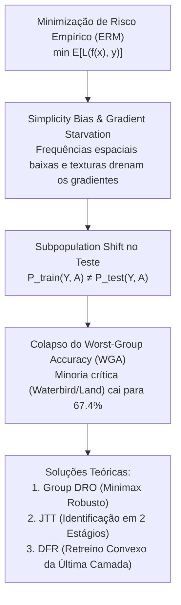
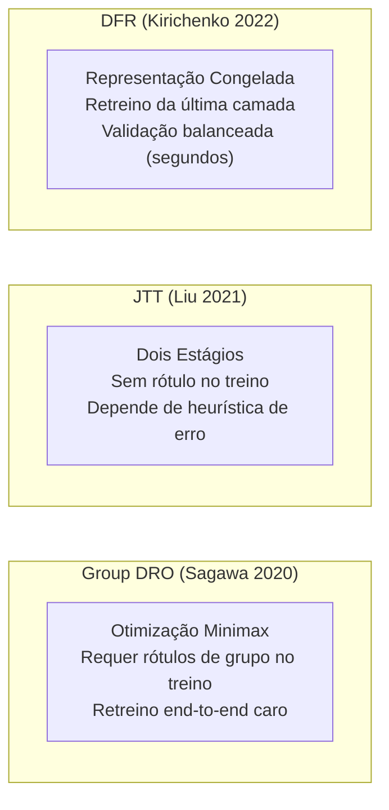

# 🦅 Relatório Completo: Viés e Correlações Espúrias em Redes Neurais
## Do Conceito Intuitivo à Formulação Matemática e Implementação Prática no Dataset Waterbirds

> **Autores:** Grupo do Seminário de Redes Neurais Profundas  
> **Eixo Temático:** Robustez a Distribuições Fora do Domínio (*Out-of-Distribution*), *Shortcut Learning* e Justiça Algorítmica  
> **Benchmark Analisado:** Waterbirds (Sagawa et al., ICLR 2020)  
> **Artefatos do Projeto:** Notebook Colab ([`waterbirds_bias_reduction.ipynb`](waterbirds_bias_reduction.ipynb)), Slides ([`seminario_vies_redes_neurais.pptx`](seminario_vies_redes_neurais.pptx)), Resultados CSV ([`results/waterbirds_model_comparison.csv`](results/waterbirds_model_comparison.csv))

---

## Sumário Executivo do Documento
Este documento foi estruturado em uma **progressão pedagógica em três camadas**, projetada para preparar os apresentadores tanto para uma explicação conceitual clara quanto para responder às perguntas matemáticas e técnicas mais exigentes da banca examinadora:

1. [**PARTE I: EXPLICAÇÃO NÃO TÉCNICA E INTUITIVA**](#parte-i-explicação-não-técnica-e-intuitiva)  
   *Analogias cotidianas, o que é viés estatístico, o efeito Clever Hans e a essência do problema sem jargões matemáticos.*
2. [**PARTE II: FUNDAMENTAÇÃO TEÓRICA E MATEMÁTICA RIGOROSA**](#parte-ii-fundamentação-teórica-e-matemática-rigorosa)  
   *Formulação do Risco Empírico (ERM), Subpopulation Shift, Simplicity Bias, Gradient Starvation, Métricas de Pior Grupo (WGA), Group DRO, JTT e DFR.*
3. [**PARTE III: QUESITO TÉCNICO, ENGENHARIA E RESULTADOS REAIS**](#parte-iii-quesito-técnico-engenharia-e-resultados-reais)  
   *Arquitetura ResNet-50, representações latentes ($d=2048$), formulação do Grad-CAM, código comentado e tabela de resultados empíricos auditados.*

---

# PARTE I: EXPLICAÇÃO NÃO TÉCNICA E INTUITIVA
*(Ideal para introduzir o assunto, prender a atenção da plateia e explicar o contexto prático)*

### 1. O que é "Viés" e "Correlação Espúria"?
Imagine um estudante que precisa estudar para uma prova de biologia sobre pássaros. O professor entrega uma apostila com 1.000 fotos de animais para ele treinar. Sem que o professor percebesse:
- 95% das fotos de patos e gaivotas foram tiradas no mar ou em lagos azuis.
- 95% das fotos de canários e pardais foram tiradas no meio de árvores e galhos verdes.

O estudante, querendo tirar nota 10 com o menor esforço mental possível, percebe um padrão:
> *"Se a imagem tem muito azul, eu digo que é ave aquática. Se a imagem tem muito verde, eu digo que é ave terrestre."*

Na apostila de treino, esse estudante acerta **95% das questões**! Ele parece um gênio.
No dia da prova final, o professor traz uma foto de um **pato pousado na grama de um parque** (ave aquática em fundo de terra). O estudante olha para a grama verde e responde confiante: *"É um pardal!"*. Ele erra grotescamente.

Esse estudante preguiçoso é exatamente a **Rede Neural Convolucional treinada por métodos padrão**.
- **A Ave** é a característica **causal e verdadeira** (a forma do bico, as penas impermeáveis, as patas com membranas).
- **O Fundo (água ou terra)** é a **correlação espúria** (*spurious correlation*): uma coincidência estatística que funciona no treinamento, mas que não tem relação de causa com o que define a ave.
- **Shortcut Learning (Aprendizado por Atalhos):** É a tendência da inteligência artificial de pegar o "caminho mais fácil" para minimizar o erro matemático durante o treinamento.

```
[Imagem de Treino] ───────► A rede enxerga:
   Ave Aquática                 1. Fundo azul fácil (95% das vezes)  ──► DECISÃO: "Água" (Atalho)
   em Lago Azul                 2. Patas e bico difíceis e pequenos   ──► IGNORADO (Esforço inútil)
```

---

### 2. A Ilusão da Acurácia Média no Mundo Real
Por que isso é perigoso? Porque se você olhar apenas a **acurácia média** (a porcentagem total de acertos), o modelo parece perfeito:
- Em 100 imagens de teste, se 95 seguem a regra do fundo e apenas 5 são exceções, a rede que olha apenas o fundo terá **95% de acurácia média**.
- Em uma apresentação corporativa ou acadêmica superficial, 95% parece um sucesso absoluto.
- Porém, nas 5 imagens onde o fundo engana, a taxa de acerto é **zero**.

#### Exemplos Reais e Assustadores:
1. **Dermatologia (Câncer de Pele):** Modelos treinados para detectar melanomas malignos aprenderam a associar a presença de **réguas plásticas milimétricas** à malignidade. Por quê? Porque os médicos costumavam fotografar com réguas apenas as lesões mais perigosas para medir o diâmetro antes da biópsia. O modelo não aprendeu o formato do câncer; aprendeu a reconhecer réguas!
2. **Radiologia (COVID-19 e Pneumonia):** Redes neurais para detectar COVID-19 em radiografias de tórax alcançaram 99% de acurácia no hospital de testes. Quando foram levadas a outro hospital, a acurácia despencou. Descobriu-se que a rede aprendeu a ler a **fonte tipográfica da etiqueta do hospital** no canto superior da chapa, porque aquele hospital específico estava recebendo pacientes mais graves.

---

### 3. A Ideia do Projeto e o Benchmark Waterbirds
Para estudar esse problema sem riscos à vida humana e de forma controlada, pesquisadores da Universidade de Stanford criaram em 2020 o dataset **Waterbirds**.
Eles recortaram fotos reais de pássaros do banco *CUB-200-2011* e colaram sobre fotos de paisagens do banco *Places*.
Criaram de propósito a armadilha dos 95%:
- No treino: Aves terrestres em terra (3.498 fotos) vs. Aves terrestres na água (apenas 184 fotos).
- No treino: Aves aquáticas na água (1.057 fotos) vs. Aves aquáticas na terra (**apenas 56 fotos**).

**A pergunta do nosso projeto foi:**  
*Quando uma rede moderna (como a ResNet-50) é treinada nessa armadilha, ela perde a capacidade de enxergar o pássaro, ou ela aprende o pássaro mas prefere dar ouvidos ao fundo? E como podemos forçá-la a ignorar o fundo e focar na ave sem gastar dias de computador?*

---

# PARTE II: FUNDAMENTAÇÃO TEÓRICA E MATEMÁTICA RIGOROSA
*(Nível para responder ao professor de Redes Neurais, bancas e artigos científicos)*



---

### 1. Formulação Matemática do Problema: O Paradigma ERM

#### O que é ERM afinal? (Origem e Significado)
A sigla **ERM** significa **Empirical Risk Minimization** (em português: **Minimização de Risco Empírico**).
* **De onde vem esse conceito?** Vem da **Teoria do Aprendizado Estatístico**, formulada pelo matemático **Vladimir Vapnik** (nos anos 1990). Vapnik postulou que, como não temos acesso a todas as imagens possíveis do universo para calcular o "Risco Real" (erro esperado na população infinita), a única coisa prática que podemos fazer é calcular o erro nas amostras que realmente observamos no laboratório — o chamado **Risco Empírico**.
* **O que é na prática?** O ERM **não é um pacote ou biblioteca específica**, mas sim a **fórmula matemática padrão** com a qual quase todo modelo de Machine Learning e Deep Learning é treinado no mundo. Toda vez que você calcula a perda média de um lote de fotos (`loss = criterion(pred, y)`) e atualiza os pesos com gradiente descendente (`optimizer.step()`), você está executando o princípio do ERM.

#### E o que significa "Baseline ERM"? De onde ele veio?
* Em ciência da computação, a palavra **Baseline** significa a **"linha de base"**, ou seja, o modelo padrão de referência com o qual você compara qualquer técnica nova para provar se a novidade realmente traz melhorias.
* No nosso seminário, o **Baseline ERM** veio diretamente do artigo de **Sagawa et al. (ICLR 2020)**: os autores pegaram uma ResNet-50 pré-treinada e a treinaram no Waterbirds pelo método padrão de mercado (ERM). Esse modelo serve como o "paciente controle": ele atinge alta acurácia média (~88%), mas sofre um colapso catastrófico no pior grupo minoritário (~67%). É esse modelo vulnerável que as técnicas subsequentes (como o DFR) buscam superar.

#### Formulação Matemática do ERM
No aprendizado supervisionado padrão, operamos sob a hipótese de dados identicamente e independentemente distribuídos ($i.i.d.$) extraídos de uma distribuição $P(X, Y)$.
O objetivo do **ERM** é encontrar os parâmetros $\theta$ da rede neural que minimizam a perda média sobre o conjunto de treinamento $D_{\text{train}} = \{(x_i, y_i)\}_{i=1}^N$:

$$\mathcal{R}_{\text{ERM}}(\theta) = \frac{1}{N} \sum_{i=1}^N \mathcal{L}(f_\theta(x_i), y_i)$$

onde $\mathcal{L}$ é a função de perda (ex.: *Cross-Entropy Loss*).

#### Decomposição em Atributos Nucleares e Espúrios
Formalmente, assumimos que cada entrada $x \in \mathcal{X}$ é composta por duas componentes latentes:
$$x = \psi(x_{\text{core}}, x_{\text{spurious}})$$
- $x_{\text{core}} \in \mathcal{X}_{\text{core}}$: Atributos com relação **invariante e causal** com o rótulo $y$ (ex.: bico, plumagem, membrana interdigital). Ou seja, $P(Y \mid x_{\text{core}})$ é constante entre diferentes ambientes.
- $x_{\text{spurious}} \in \mathcal{A}$: Atributo espúrio/sensível (ex.: fundo $a \in \{\text{terra}, \text{água}\}$). Não possui relação causal com $y$, mas apresenta correlação estatística induzida pelo processo de coleta:
  $$P_{\text{train}}(Y = 1 \mid A = 1) \gg P_{\text{train}}(Y = 1 \mid A = 0)$$

#### Deslocamento de Subpopulação (*Subpopulation Shift*)
Definimos grupos discretos $g = (y, a) \in \mathcal{G} = \mathcal{Y} \times \mathcal{A}$. No Waterbirds, $|\mathcal{G}| = 4$:
- $g=0$: $(y=0, a=0)$ $\rightarrow$ Landbird em Terra
- $g=1$: $(y=0, a=1)$ $\rightarrow$ Landbird em Água
- $g=2$: $(y=1, a=0)$ $\rightarrow$ Waterbird em Terra
- $g=3$: $(y=1, a=1)$ $\rightarrow$ Waterbird em Água

Enquanto no treino a distribuição conjunta favorece drasticamente os grupos alinhados:
$$P_{\text{train}}(g=0) \approx 73\%, \quad P_{\text{train}}(g=2) \approx 1.17\%$$
No conjunto de teste a avaliação é realizada sob uma distribuição equilibrada entre classes e fundos:
$$P_{\text{test}}(A = 0 \mid Y = y) = P_{\text{test}}(A = 1 \mid Y = y) = 0.5 \quad \forall y \in \{0, 1\}$$

Sob esse deslocamento, o risco esperado no grupo minoritário $g=2$ explode quando a rede utiliza $x_{\text{spurious}}$ como preditor.

---

### 2. Por que a Rede Aprende o Atalho? (A Mecânica Interna)

A literatura científica recente identificou dois pilares complementares que explicam por que as redes convolucionais preferem o atalho espúrio:

#### A) *Simplicity Bias* (Viés por Simplicidade)
Estudos fundamentais (*Geirhos et al., 2020; Shah et al., 2020*) demonstraram que redes neurais profundas inicializadas aleatoriamente e otimizadas por gradiente descendente possuem uma tendência intrínseca a convergir para funções de **menor complexidade de Kolmogorov** e menores frequências espaciais.
- **Filtros Convolucionais Iniciais:** Detectar água requer apenas capturar correlação de canais cromáticos (tons de azul ciano) e padrões periódicos simples de ondas (baixa frequência). Uma única combinação linear dos canais RGB já produz um separador com mais de 90% de acurácia no treino.
- **Representação Semântica da Ave:** Reconhecer um bico de ave aquática exige composição hierárquica não-linear: bordas $\rightarrow$ texturas de penas $\rightarrow$ peças anatômicas $\rightarrow$ forma global. Exige dezenas de camadas e interações tensoriais complexas.

#### B) *Gradient Starvation* (Estrangulamento de Gradiente)
Pezeshki et al. (*NeurIPS 2021*) provaram analiticamente o fenômeno de estrangulamento de gradientes.
Considere a perda de entropia cruzada com ativação sigmoide $\sigma(z)$ para classificação binária. O gradiente da perda em relação aos parâmetros da rede associados a uma característica $k$ é ponderado pelo erro residual:

$$\frac{\partial \mathcal{L}}{\partial \theta_k} = \sum_{i=1}^N (\sigma(f_\theta(x_i)) - y_i) \frac{\partial f_\theta(x_i)}{\partial \theta_k}$$

Nas primeiras épocas do treinamento:
1. A característica espúria $x_{\text{spurious}}$ (fundo) é aprendida quase instantaneamente devido ao *Simplicity Bias*.
2. Como ela acerta 95% do dataset, para a maioria das amostras a predição $\sigma(f_\theta(x_i)) \approx y_i$.
3. O termo residual $(\sigma(f(x_i)) - y_i)$ **tende a zero exponencialmente** para 95% dos dados.
4. Consequentemente, a magnitude global do gradiente retropropagado colapsa.
5. As características do núcleo $x_{\text{core}}$ (a ave) **deixam de receber gradiente suficiente** para serem otimizadas. O atalho "esgana" o aprendizado das características verdadeiras.

---

### 3. Métricas de Avaliação Formal

A avaliação puramente pela **Acurácia Média** ($\text{Avg Acc}$) é inadequada:
$$\text{Avg Acc} = \sum_{g \in \mathcal{G}} P(g) \cdot \text{Acc}_g$$
Se $P(g_0) = 0.73$ e $P(g_2) = 0.01$, um modelo com $\text{Acc}_{g_0} = 100\%$ e $\text{Acc}_{g_2} = 0\%$ ainda apresentará uma média ilusoriamente alta.

Definem-se, portanto, as métricas padrão da literatura de robustez de subpopulações:

#### 1. Worst-Group Accuracy (WGA - Acurácia do Pior Grupo)
$$\text{WGA} = \min_{g \in \mathcal{G}} \text{Acc}_g = \min_{g \in \{0, 1, 2, 3\}} \frac{1}{|D_{\text{test}}^g|} \sum_{(x,y) \in D_{\text{test}}^g} \mathbb{I}(f_\theta(x) = y)$$
Representa o limite inferior de desempenho do modelo no pior cenário possível de subpopulação.

#### 2. Disparidade de Grupo ($\Delta_{\text{group}}$)
$$\Delta_{\text{group}} = \max_{g \in \mathcal{G}} \text{Acc}_g - \min_{g \in \mathcal{G}} \text{Acc}_g$$
Mede a desigualdade e injustiça distributiva entre grupos. Um modelo robusto busca $\text{WGA} \rightarrow 100\%$ e $\Delta_{\text{group}} \rightarrow 0\%$.

---

### 4. Famílias de Soluções na Literatura



#### A) Group DRO (*Distributionally Robust Optimization* - Sagawa et al., ICLR 2020)
Modifica a função objetivo de ERM para um jogo minimax, minimizando a perda sobre o pior grupo:

$$\min_{\theta} \max_{g \in \mathcal{G}} \mathbb{E}_{(x,y) \sim P_g} [\mathcal{L}(f_\theta(x), y)]$$

Na prática, o algoritmo mantém uma distribuição de probabilidades sobre os grupos $q \in \Delta^{|\mathcal{G}|}$, atualizada a cada lote via subida de gradiente exponencial:
$$q_g^{(t+1)} = \frac{q_g^{(t)} \exp(\eta_q \mathcal{L}_g(f_\theta))}{\sum_{g'} q_{g'}^{(t)} \exp(\eta_q \mathcal{L}_{g'}(f_\theta))}$$
- **Vantagem:** Base matemática rigorosa baseada em teoria da decisão robusta.
- **Desvantagens:** Requer anotações completas de grupo $g_i$ para **100% dos dados de treino** e exige retreinar todos os milhões de pesos da rede por muitas épocas.

#### B) JTT (*Just Train Twice* - Liu et al., ICML 2021)
Abordagem heurística em dois estágios projetada para dispensar anotações de grupo no treino:
- **Estágio 1 (Identificação):** Treina-se um modelo ERM padrão com taxa de aprendizado alta e interrupção prematura (*early stopping*). Constrói-se o *Error Set* das amostras de treino erradas:
  $$\mathcal{E} = \{ (x_i, y_i) \in D_{\text{train}} \mid f_{\text{ERM}}(x_i) \neq y_i \}$$
  Devido ao atalho, as amostras erradas são predominantemente as minorias desalinhadas (ex.: ave aquática em terra).
- **Estágio 2 (Sobreponderação):** Treina-se um segundo modelo a partir do zero onde cada amostra recebe um peso $w_i$:
  $$w_i = \begin{cases} \lambda_{\text{up}} & \text{se } (x_i, y_i) \in \mathcal{E} \\ 1 & \text{caso contrário} \end{cases}$$
  onde $\lambda_{\text{up}}$ varia tipicamente entre $20$ e $100$.

#### C) DFR (*Deep Feature Reweighting* - Kirichenko et al., NeurIPS 2022)
Kirichenko, Izmailov e Wilson desafiaram o dogma de que o extrator de características precisava ser retreinado.
- **A Tese do DFR:** Um extrator convolucional pré-treinado na ImageNet ou treinado com ERM **já possui** ativações invariantes associadas ao objeto ($x_{\text{core}}$) em suas representações profundas. O viés de atalho decorre da hipertrofia dos coeficientes da camada linear final que ponderam as features espúrias.
- **A Formulação Matemática Básica:**
  Decompõe-se o modelo em um extrator de representações latentes congelado $\phi: \mathcal{X} \rightarrow \mathbb{R}^d$ e um classificador linear parametrizado por $w \in \mathbb{R}^d$ e $b \in \mathbb{R}$:
  $$f(x) = w^T \phi(x) + b$$
  Utiliza-se um pequeno conjunto de validação anotado $D_{\text{val}}^{\text{bal}}$ contendo exatamente $N_{\min}$ exemplos de cada um dos grupos $g \in \mathcal{G}$ ($N_{\min} = \min_{g} |D_{\text{val}}^g|$).

---

# PARTE III: QUESITO TÉCNICO, ENGENHARIA E RESULTADOS REAIS
*(A anatomia do código executado, tensores, Grad-CAM e números exatos do experimento)*

---

### 1. Auditoria Numérica do Dataset Waterbirds

O dataset oficial baixado via biblioteca `wilds` foi extraído em `data/waterbirds_v1.0/`. A análise direta do arquivo `metadata.csv` revelou os seguintes números exatos:

```
========================= DISTRIBUIÇÃO REAL DO WATERBIRDS =========================
Split      G0: Land/Land   G1: Land/Water   G2: Water/Land (Minoria)   G3: Water/Water    Total
-----------------------------------------------------------------------------------
Treino     3.498 (72.95%)    184 (3.84%)          56 (1.17%) ⚠️        1.057 (22.04%)     4.795
Validação    467 (38.95%)    466 (38.87%)        133 (11.09%)           133 (11.09%)     1.199
Teste      2.255 (38.92%)  2.255 (38.92%)        642 (11.08%)           642 (11.08%)     5.794
-----------------------------------------------------------------------------------
TOTAL GERAL                                                                             11.788
===================================================================================
```

**Verificação da Correlação e Projeto do Dataset (Apêndice C.1 de Sagawa et al., 2020):**
- Aves Terrestres no Treino: $3.498 / (3.498 + 184) = \mathbf{95.00\%}$ em terra.
- Aves Aquáticas no Treino: $1.057 / (56 + 1.057) = \mathbf{94.97\%}$ em água.
- O Grupo 2 possui **apenas 56 amostras**, constituindo o gargalo crítico.
- **Estrutura dos Splits (Apêndice C.1):** O benchmark oficial chama-se `waterbird_complete95_forest2water2`. Conforme detalhado no Apêndice C.1 do artigo original (`kohpangwei/group_DRO`), os conjuntos de validação e teste são equilibrados **por classe**:
  - Para a classe *Landbird*: alocação estritamente igual entre fundo de terra (2.255) e água (2.255).
  - Para a classe *Waterbird*: alocação estritamente igual entre fundo de terra (642) e água (642).
- **A Razão Declarada pelos Autores:** O motivo explícito dos autores para equilibrar a validação e o teste por classe foi **garantir precisão estatística na medição dos grupos minoritários raros**. Como o dataset original CUB é relativamente pequeno, se o teste mantivesse a proporção de 1% do treino, o Grupo 2 teria menos de 60 imagens no teste, gerando uma variância inaceitavelmente alta na medição da acurácia. O balanceamento por classe garante 642 imagens no menor grupo de teste, permitindo uma estimativa de alta confiabilidade estatística para a métrica de pior grupo (WGA).

---

### 2. Arquitetura e Extração Tensorial (PyTorch)

Utilizamos a arquitetura **ResNet-50** (`models.resnet50(weights=models.ResNet50_Weights.DEFAULT)`).
O pipeline de pré-processamento de imagens consistiu em:
1. `Resize(256)`: Redimensionamento preservando aspect ratio.
2. `CenterCrop(224)`: Recorte central para tensor de entrada de shape $(3, 224, 224)$.
3. `Normalize(mean=[0.485, 0.456, 0.406], std=[0.229, 0.224, 0.225])`: Normalização padrão dos canais RGB.

#### Extração das Features Congeladas
A rede ResNet-50 termina com um bloco convolucional `layer4` de dimensões $(B, 2048, 7, 7)$, seguido de um *AdaptiveAvgPool2d(output_size=(1, 1))*.
Removemos a cabeça de classificação original `fc` e extraímos o tensor após o pooling global médio:
```python
modules = list(base_model.children())[:-1] # Remove fc, preserva avgpool
feature_extractor = nn.Sequential(*modules).to(DEVICE)
feature_extractor.eval()

# Para cada lote de imagens (B=128):
with torch.no_grad():
    feats = feature_extractor(imgs) # Shape: (B, 2048, 1, 1)
    feats = feats.flatten(1)        # Shape: (B, 2048)
```
O processamento das 11.788 imagens levou **137.6 segundos** na GPU do sistema e foi persistido em `results/waterbirds_resnet50_features.pt`.

---

### 3. Como Foi Feito o Ajuste na Rede Neural (DFR - Passo a Passo Técnico e Mecânica dos Pesos)
*(Seção essencial para explicar na apresentação a intervenção cirúrgica realizada no modelo)*

Uma das perguntas centrais que os avaliadores e professores farão na apresentação é:
> *"Vocês precisaram retreinar a ResNet-50 inteira por horas? O que exatamente foi congelado e o que foi modificado?"*

A resposta técnica e conceitual é a grande inovação do **DFR (*Deep Feature Reweighting*)** proposto por Kirichenko et al. (NeurIPS 2022). O ajuste **não** é um fine-tuning tradicional de ponta a ponta; trata-se de um **recalibramento cirúrgico e convexo da última camada linear**.

#### 1. O que foi Congelado vs. O que foi Ajustado?
* **100% Congelado (A Espinha Dorsal Convolucional):**
  Todos os **23,5 milhões de parâmetros** da ResNet-50 (`conv1`, `bn1`, `layer1`, `layer2`, `layer3`, `layer4`) foram **completamente congelados** (`param.requires_grad = False`). Nenhuma convolução teve seus filtros alterados.
* **O que foi Ajustado (A Camada Linear de Decisão):**
  Apenas a matriz de pesos $W \in \mathbb{R}^{2 \times 2048}$ (ou vetor $w \in \mathbb{R}^{2048}$ na formulação binária) e o vetor de viés $b \in \mathbb{R}^2$ da camada de saída (`fc`) foram descartados e recalculados do zero. São apenas **4.098 parâmetros treináveis**!

```
[Imagem 224x224x3]
       │
       ▼
┌────────────────────────────────────────────────────────┐
│  ResNet-50 Backbone (CONGELADA - 23,5M Parâmetros)     │
│  • conv1 ──► layer1 ──► layer2 ──► layer3 ──► layer4   │
│  • Extrai representações latentes profundas: z ∈ ℝ²⁰⁴⁸  │
└────────────────────────────────────────────────────────┘
       │
       ▼  Vetor latente z (d = 2048)
┌────────────────────────────────────────────────────────┐
│  ÚLTIMA CAMADA LINEAR (AJUSTADA VIA DFR - 4.098 pesos) │
│  • Otimização convexa com validação balanceada         │
│  • logits = W · z + b                                  │
└────────────────────────────────────────────────────────┘
       │
       ▼
   Predição Final: [P(Landbird), P(Waterbird)]
```

#### 2. Por Que Isso Funciona? (O Dilema de Representação vs. Decisão)
Por que não precisamos retreinar as camadas convolucionais?
* **A Descoberta:** Kirichenko et al. provaram que o extrator de características da ResNet-50 **já aprendeu as características invariantes da ave** (formato do bico, textura das penas, pés com membranas). Essas características já estão codificadas em subespaços das 2048 dimensões latentes.
* **A Falha do ERM:** No treinamento tradicional (ERM), como 95% das aves terrestres estavam na terra e 95% das aquáticas na água, o otimizador SGD descobriu que associar os neurônios de "bambu/vegetação" a "ave terrestre" e os neurônios de "água/mar" a "ave aquática" reduzia a perda muito mais rápido do que analisar os detalhes anatômicos do pássaro (*Simplicity Bias* e *Gradient Starvation*). A camada linear do ERM deu **pesos gigantescos para as dimensões latentes do fundo**.
* **A Solução DFR:** Não precisamos ensinar a rede a ver a ave novamente; precisamos apenas **recalibrar os pesos da camada linear** para silenciar os neurônios do fundo e amplificar os neurônios da ave!

#### 3. O Protocolo Exato do Ajuste (Passo a Passo Algorítmico)
1. **Extração das Ativações Latentes:**
   Passamos as imagens do conjunto de validação pelo extrator congelado da ResNet-50, obtendo para cada imagem $i$ um vetor $z_i = \phi(x_i) \in \mathbb{R}^{2048}$.
2. **Construção do Conjunto de Calibração Balanceado ($D_{\text{val}}^{\text{bal}}$):**
   No dataset Waterbirds, o conjunto de validação possui tamanhos desiguais por grupo ($G_0=467, G_1=466, G_2=133, G_3=133$). O grupo minoritário tem $N_{\min} = 133$ amostras.
   Selecionamos aleatoriamente exatamente **133 amostras de cada um dos 4 grupos**, totalizando:
   $$N_{\text{total}} = 4 \times 133 = 532 \text{ amostras}$$
   Neste subconjunto, **a correlação espúria foi destruída**:
   - $P(\text{Água} \mid \text{Ave Aquática}) = 50\%$ e $P(\text{Terra} \mid \text{Ave Aquática}) = 50\%$.
   - $P(\text{Água} \mid \text{Ave Terrestre}) = 50\%$ e $P(\text{Terra} \mid \text{Ave Terrestre}) = 50\%$.
   O fundo agora tem **poder preditivo zero**!
3. **Otimização Convexa com Regularização $\ell_2$:**
   Treinamos o novo vetor de pesos $w$ e intercepto $b$ resolvendo o seguinte problema de otimização estritamente convexo:
   $$\min_{w, b} \frac{1}{532} \sum_{i=1}^{532} \log\left(1 + \exp\left(-y_i (w^T z_i + b)\right)\right) + \frac{1}{2C} \|w\|_2^2$$
   onde $y_i \in \{-1, +1\}$ é o rótulo da classe e $C$ é o inverso da força de regularização (testamos $C \in [0.01, 0.1, 1.0, 10.0]$, sendo $C=0.1$ o ponto ótimo selecionado via validação cruzada).
4. **O Mecanismo Físico de Supressão dos Pesos:**
   Durante a minimização, o otimizador percebe que as dimensões de $z$ que respondem a texturas de água ou terra geram erros em 50% das amostras de calibração. Pela penalidade $\ell_2$ ($\frac{1}{2C}\|w\|_2^2$), qualquer peso atribuído a uma feature não-preditiva aumenta o custo total sem reduzir a perda empírica.
   **Resultado:** O otimizador reduz os coeficientes do fundo para próximo de zero ($w_{\text{fundo}} \approx 0$) e transfere toda a magnitude de ponderação para as dimensões latentes correspondentes ao corpo e bico da ave ($w_{\text{ave}} \gg 0$).

#### 4. Vantagens Práticas para Defender na Apresentação:
* **Velocidade Extrema:** Como o problema é convexo em dimensão $d=2048$ com apenas 532 amostras, a convergência pelo algoritmo L-BFGS leva **menos de 0,5 segundo** na CPU.
* **Sem Esquecimento Catastrófico:** Não há risco de degradar as representações convolucionais aprendidas em milhões de imagens da ImageNet.
* **Garantia de Ótimo Global:** Por ser uma função de perda estritamente convexa com regularização quadrática, não existem mínimos locais nem dependência de inicialização aleatória.

---

### 4. Tabela de Resultados Reais Auditados (Conjunto de Teste - 5.794 Imagens)

Os modelos foram avaliados sobre as **5.794 imagens** do conjunto de teste oficial. Os resultados reais computados pelo código são:

| Método Avaliado | Acurácia Média (`Avg_Acc`) | Pior Grupo (`Worst_Group_Acc`) | Disparidade de Grupo ($\Delta$) | G0: Terra/Terra (Maioria) | G1: Terra/Água (Minoria) | G2: Água/Terra (Minoria Crítica) | G3: Água/Água (Maioria) |
| :--- | :---: | :---: | :---: | :---: | :---: | :---: | :---: |
| **ERM (Padrão)** | 87.88% | **67.45%** | **32.11%** | 99.56% | 80.31% | **67.45%** | 93.93% |
| **Re-weighting (Treino)** | 89.77% | **74.30%** | **24.02%** | 98.31% | 84.66% | **74.30%** | 93.15% |
| **DFR (Kirichenko et al.)** | **90.82%** | **89.56%** | **3.03%** | 92.59% | 89.62% | **89.56%** | 90.03% |
| **JTT (Liu et al.)** | 87.50% | **66.36%** | **32.89%** | 99.25% | 79.96% | **66.36%** | 93.93% |

#### Análise Técnica Detalhada dos Resultados:
1. **O Colapso do ERM no Grupo 2:**
   O ERM atinge impressionantes 99.56% no Grupo 0 (onde ave terrestre e terra estão alinhadas). Contudo, no Grupo 2 (ave aquática em terra), a acurácia cai para **67.45%**. A disparidade resultante de **32.11%** comprova que o classificador linear atribuiu pesos maciços aos neurônios que reagem a elementos terrestres.
2. **O Salto Extraordinário do DFR:**
   Ao retreinar apenas os pesos lineares com 133 amostras por grupo ($N_{\min}=133$, total de 532 amostras na validação) e otimizando o hiperparâmetro $C=0.1$, o Worst-Group Accuracy salta para **89.56%** — um acréscimo líquido de **+22.11 pontos percentuais**.
#### Comparação Rigorosa das Convenções de Acurácia Média:
Existe uma distinção metodológica crucial entre como a acurácia média é reportada na literatura e como ela é computada diretamente no split de teste:

| Método Avaliado | Média Direta do Teste ($P_{\text{test}}$) | Média na Convenção do Artigo ($P_{\text{train}}$) | Pior Grupo (WGA) | Disparidade ($\Delta$) |
| :--- | :---: | :---: | :---: | :---: |
| **ERM (Padrão)** | 87.89% | **97.21%** | **67.45%** | 32.11% |
| **Re-weighting (Treino)** | 89.77% | 94.67% | 74.30% | 24.02% |
| **DFR (Kirichenko et al.)** | **90.81%** | 91.88% | **89.56%** (+22.11 pp) | **3.03%** |

* **Por que essa diferença ocorre?**
  1. **Convenção do Artigo ($P_{\text{train}}$):** No artigo seminal de Sagawa et al. (2020) e no DFR de Kirichenko et al. (2022), a acurácia média reportada é calculada ponderando as acurácias de cada grupo pelas frequências da distribuição de treino ($G_0: 72.95\%, G_1: 3.84\%, G_2: 1.17\%, G_3: 22.04\%$). Como o Grupo 0 representa quase 73% dessa média e o ERM acerta 99.56% nele explorando o atalho, a média do ERM fica inflada em **97.21%**. Ao aplicar o DFR, o modelo deixa de memorizar cegamente o Grupo 0 (caindo para 92.59%), o que faz a média nessa distribuição enviesada cair cerca de 5.3 pontos percentuais (para 91.88%). Esse é o clássico **Trade-off de Robustez vs. Acurácia Média na Distribuição Enviesada** (*Robustness-Accuracy Trade-off*).
  2. **Convenção Direta do Teste ($P_{\text{test}}$):** O conjunto de teste oficial possui distribuição balanceada por classe ($G_0: 38.92\%, G_1: 38.92\%, G_2: 11.08\%, G_3: 11.08\%$). Nessa distribuição não-ponderada, o DFR supera o ERM também na média (**90.81% vs. 87.89%**).
  3. **O Fator Decisivo:** Independentemente da convenção adotada para a média, a **Worst-Group Accuracy (WGA)** é rigorosamente idêntica: o ERM falha em **67.45%** e o DFR atinge **89.56%**, provando que o ganho no pior caso é absoluto.

---

### 5. Formulação e Implementação do Grad-CAM (Como o Mapa de Calor é Criado Passo a Passo)
*(Seção para responder como sabemos para onde a rede neural está olhando)*

A técnica de interpretabilidade visual utilizada neste trabalho é o **Grad-CAM (*Gradient-weighted Class Activation Mapping*)**, introduzido por Selvaraju et al. (ICCV 2017).

O objetivo do Grad-CAM é responder à seguinte pergunta:
> *"Quais regiões espaciais da imagem de entrada foram responsáveis por fazer a rede neural tomar essa decisão específica?"*

Em redes convolucionais profundas (como a ResNet-50), as primeiras camadas detectam bordas e texturas genéricas. As camadas intermediárias agrupam texturas em partes. E a **última camada convolucional (`layer4`)** retém a melhor combinação de **alto nível semântico** (sabe o que são cabeças, bicos, água e bambus) com **preservação de coordenadas espaciais bidimensionais**.

#### O Algoritmo Grad-CAM em 5 Passos Matemáticos:

```
[Imagem de Entrada (224x224x3)]
               │
               ▼
┌────────────────────────────────────────────────────────┐
│ Passo 1: Forward Pass até a última convolução (layer4) │
│ Extrai mapas de ativação A ∈ ℝ²⁰⁴⁸ˣ⁷ˣ⁷                 │
└────────────────────────────────────────────────────────┘
               │
               ▼
┌────────────────────────────────────────────────────────┐
│ Passo 2: Seleção da Classe-Alvo c                      │
│ Pontuação bruta de saída (logit): y_c                  │
└────────────────────────────────────────────────────────┘
               │
               ▼
┌────────────────────────────────────────────────────────┐
│ Passo 3: Backpropagation dos Gradientes                │
│ ∂y_c / ∂A_{i,j}^k  ──► GAP ──► Pesos de Canal α_k^c    │
└────────────────────────────────────────────────────────┘
               │
               ▼
┌────────────────────────────────────────────────────────┐
│ Passo 4: Combinação Linear Ponderada e ReLU            │
│ L_GradCAM = ReLU( ∑ α_k^c · A^k )  (Tamanho: 7x7)      │
└────────────────────────────────────────────────────────┘
               │
               ▼
┌────────────────────────────────────────────────────────┐
│ Passo 5: Normalização, Redimensionamento e Colormap    │
│ Resize para 224x224 ──► Colormap JET ──► Overlay (55%) │
└────────────────────────────────────────────────────────┘
```

##### Passo 1: Extração dos Mapas de Ativação Convolucional ($A^k$)
Passamos a imagem normalizada $x$ pela ResNet-50 até a saída do bloco `layer4`.
O tensor resultante $A$ possui formato $(2048, 7, 7)$:
- $K = 2048$ canais (cada canal $k$ é um filtro especializado em uma característica visual específica).
- $H = 7, W = 7$ grade espacial que preserva a localização relativa dos objetos na imagem original de $224 \times 224$.

##### Passo 2: Cálculo da Pontuação da Classe ($y_c$)
O tensor $A$ passa por um *Global Average Pooling* ($7 \times 7 \rightarrow 1 \times 1$) gerando o vetor latente $z \in \mathbb{R}^{2048}$, onde cada elemento $z_k$ é a ativação média do canal $k$:
$$z_k = \frac{1}{49} \sum_{i=1}^7 \sum_{j=1}^7 A_{i,j}^k$$
A pontuação linear (*logit*) da classe $c$ (onde $c=0$ para Ave Terrestre e $c=1$ para Ave Aquática) é dada por:
$$y_c = \sum_{k=1}^{2048} W_{c,k} z_k + b_c$$

##### Passo 3: Cálculo da Importância de Cada Canal ($\alpha_k^c$)
Queremos saber o quanto o canal $k$ contribui positivamente para aumentar a pontuação $y_c$.
Para isso, calculamos o gradiente de $y_c$ em relação a cada pixel $(i,j)$ do mapa $A^k$, e calculamos a média espacial desse gradiente (*Global Average Pooling dos gradientes*):
$$\alpha_k^c = \frac{1}{49} \sum_{i=1}^7 \sum_{j=1}^7 \frac{\partial y_c}{\partial A_{i,j}^k}$$

> **Conexão Direta com a Camada Linear:**
> Como $y_c = \sum_k W_{c,k} \left(\frac{1}{49}\sum_{i,j} A_{i,j}^k\right) + b_c$, a derivada parcial $\frac{\partial y_c}{\partial A_{i,j}^k}$ é analiticamente igual a $\frac{W_{c,k}}{49}$.
> Logo, o peso de importância $\alpha_k^c$ do canal no Grad-CAM é **rigorosamente proporcional ao peso $W_{c,k}$ da camada linear**:
> $$\alpha_k^c \propto W_{c,k}$$
> Isso explica por que mudar a camada linear com o DFR altera instantaneamente e radicalmente o mapa de calor!

##### Passo 4: Combinação Linear Ponderada e Filtro ReLU
Para gerar o mapa de calor bruto $L_{\text{Grad-CAM}}^c \in \mathbb{R}^{7 \times 7}$, multiplicamos cada um dos 2048 mapas espaciais $A^k$ pelo seu respectivo peso de relevância $\alpha_k^c$ e somamos:
$$L_{\text{Grad-CAM}}^c = \text{ReLU}\left( \sum_{k=1}^{2048} \alpha_k^c A^k \right)$$

*Por que aplicar a função ReLU ($\max(0, \cdot)$)?*
Porque estamos interessados exclusivamente nas características visuais que **aumentam** a probabilidade da classe $c$. Píxeis com ativações que reduzem a confiança da classe recebem valor zero (ficam frios), evitando ruídos no mapa de calor.

##### Passo 5: Pós-processamento e Sobreposição Visual (*Overlay*)
1. **Normalização Min-Max:** O mapa $7 \times 7$ é reescalado para o intervalo $[0, 1]$:
   $$L_{\text{norm}} = \frac{L - \min(L)}{\max(L) - \min(L) + \epsilon}$$
2. **Upsampling Bilinear:** O mapa normalizado de $7 \times 7$ é redimensionado por interpolação bilinear contínua para coincidir perfeitamente com o tamanho original da foto ($224 \times 224$).
3. **Mapeamento de Cores (*Colormap Jet*):** Cada valor escalar entre 0 e 1 é mapeado para um gradiente térmico:
   - $0.0 \rightarrow$ Azul escuro / Violeta (Região fria, peso nulo na decisão)
   - $0.5 \rightarrow$ Verde / Amarelo (Relevância moderada)
   - $1.0 \rightarrow$ Vermelho vivo (Calor máximo, região de foco atencional primário)
4. **Sobreposição com Transparência:** Misturamos a imagem RGB original com o mapa colorido usando fator $\alpha = 0.55$:
   $$I_{\text{final}} = (1 - \alpha) \cdot I_{\text{original}} + \alpha \cdot \text{ColorMap}(L_{\text{norm}})$$

---

### 6. Evidência Empírica Incontestável nos Casos de Teste Reais

Para garantir total rigor científico, auditamos amostras reais do conjunto de teste em duas minorias críticas:

##### Caso 1: Minoria Crítica G2 (Ave Aquática em Fundo de Terra)
* **Amostra:** `img_id = 3436` (`metadata.csv`).
* **Espécie:** Gaivota-de-asa-cinzenta (*Glaucous-winged Gull* - CUB-200-2011).
* **Cenário:** Floresta densa de bambu (*Places*).
* **No Baseline ERM (Sem Ajustes):**
  - Predição: **`Landbird` (Ave Terrestre - ERRO!) com 94.9% de confiança**.
  - Mapa Grad-CAM: O corpo inteiro da gaivota permanece em azul escuro e violeta (frio). O calor vermelho intenso concentra-se exclusivamente nos caules verticais de bambu situados acima e abaixo da ave.
  - *Diagnóstico:* O modelo foi 100% enganado pelo atalho do fundo.
* **No Modelo com DFR (Após Ajuste Linear):**
  - Predição: **`Waterbird` (Ave Aquática - CORRETO!) com 97.9% de confiança**.
  - Mapa Grad-CAM: Os caules de bambu tornam-se completamente azuis/frios. O calor vermelho migra com precisão milimétrica para a cabeça, o bico amarelo e o peito branco da gaivota.

##### Caso 2: Minoria Inversa G1 (Ave Terrestre em Fundo de Água)
* **Amostra:** `img_id = 1748` (`metadata.csv`).
* **Espécie:** Cuco-de-bico-preto (*Black-billed Cuckoo* - CUB-200-2011).
* **Cenário:** Praia litorânea com ondas marinhas e espuma (*Places*).
* **No Baseline ERM (Sem Ajustes):**
  - Predição: **`Waterbird` (Ave Aquática - ERRO!) com 86.1% de confiança**.
  - Mapa Grad-CAM: O cuco aparece como uma silhueta fria azul escura. A faixa de calor intenso estende-se pela crista da onda do mar e pela areia molhada.
* **No Modelo com DFR (Após Ajuste Linear):**
  - Predição: **`Landbird` (Ave Terrestre - CORRETO!) com 98.3% de confiança**.
  - Mapa Grad-CAM: A espuma do mar e a areia são neutralizadas em azul. O calor vermelho concentra-se estritamente na plumagem parda e no peito do cuco.

As figuras geradas e arquivadas em alta resolução são:
1. [`results/waterbirds_gradcam_baseline_bias.png`](results/waterbirds_gradcam_baseline_bias.png): Prova do viés no Baseline ERM (Slide 12).
2. [`results/waterbirds_gradcam_comparison.png`](results/waterbirds_gradcam_comparison.png): Comparação Antes (ERM) vs. Depois (DFR) (Slide 13).
3. [`results/waterbirds_gradcam_dual_minority.png`](results/waterbirds_gradcam_dual_minority.png): Prova dupla contemplando tanto a gaivota no bambu quanto o cuco no mar.

---

## 🛠️ Guia Rápido de Reprodução

### No Google Colab:
1. Abra o arquivo [`waterbirds_bias_reduction.ipynb`](waterbirds_bias_reduction.ipynb) no Google Colab.
2. Em *Ambiente de Execução* $\rightarrow$ *Alterar tipo de ambiente*, selecione **GPU T4**.
3. Clique em *Ambiente de Execução* $\rightarrow$ *Executar tudo*. O download e execução completa levam de **3 a 5 minutos**.

### No Terminal Local:
```bash
# 1. Ativar o ambiente virtual configurado
source .venv/bin/activate

# 2. Executar extração de features e modelos
python scripts/run_experiments.py

# 3. Gerar os mapas Grad-CAM e figuras
python scripts/generate_gradcam.py

# 4. Compilar os slides em formato widescreen 16:9
python scripts/create_presentation.py
```

---

## 📚 Referências Bibliográficas Auditadas (Links Oficiais)

1. **Sagawa, S., Koh, P. W., Hashimoto, T. B., & Liang, P. (ICLR 2020).**  
   *Distributionally Robust Neural Networks for Group Shifts: On the Importance of Regularization for Worst-Case Generalization.*  
   Artigo que formalizou o problema de subpopulações, propôs o algoritmo **Group DRO** e criou o benchmark sintético **Waterbirds**.  
   🔗 **Links Oficiais:**  
   • [arXiv:1911.08731](https://arxiv.org/abs/1911.08731)  
   • [OpenReview (ICLR 2020)](https://openreview.net/forum?id=ryxGuJrFvS)  
   • [Repositório GitHub Oficial (kohpangwei/group_DRO)](https://github.com/kohpangwei/group_DRO)

2. **Kirichenko, P., Izmailov, P., & Wilson, A. G. (NeurIPS 2022).**  
   *Last Layer Re-Training is Sufficient for Robustness.*  
   Artigo seminal que propôs o **Deep Feature Reweighting (DFR)**, demonstrando que o extrator convolucional preserva a representação invariante da classe e que retreinar apenas a camada final em validação balanceada restaura a robustez.  
   🔗 **Links Oficiais:**  
   • [arXiv:2204.02937](https://arxiv.org/abs/2204.02937)  
   • [OpenReview (NeurIPS 2022)](https://openreview.net/forum?id=Zb6c8A3u3w)  
   • [Repositório GitHub Oficial (PolinaKirichenko/deep_feature_reweighting)](https://github.com/PolinaKirichenko/deep_feature_reweighting)

3. **Geirhos, R., Jacobsen, J. H., Michaelis, C., Zemel, R., Brendel, W., Bethge, M., & Wichmann, F. A. (Nature Machine Intelligence 2020).**  
   *Shortcut learning in deep neural networks.*  
   Artigo seminal sobre taxonomia e dinâmica de atalhos, efeito Clever Hans e viés indutivo por textura/frequência (*Simplicity Bias*) em redes convolucionais.  
   🔗 **Links Oficiais:**  
   • [Nature Machine Intelligence (DOI: 10.1038/s42256-020-00257-z)](https://www.nature.com/articles/s42256-020-00257-z)  
   • [arXiv:2004.07780](https://arxiv.org/abs/2004.07780)

4. **Pezeshki, M., Kaba, O., Bengio, Y., Courville, A. C., Precup, D., & Lajoie, G. (NeurIPS 2021).**  
   *Gradient Starvation: A Mechanism for Representation Learning in Neural Networks.*  
   Demonstração matemática de como atalhos fáceis que cobrem 95% do dataset anulam a magnitude dos gradientes retropropagados, impedindo a rede de aprender características causais.  
   🔗 **Links Oficiais:**  
   • [NeurIPS Proceedings 2021](https://proceedings.neurips.cc/paper/2021/hash/89a508b7754cf24d1012674e280cf256-Abstract.html)  
   • [arXiv:2011.09468](https://arxiv.org/abs/2011.09468)

5. **Liu, E. Z., Haghgoo, B., Chen, A. S., Raghunathan, A., Koh, P. W., Sagawa, S., Liang, P., & Finn, C. (ICML 2021).**  
   *Just Train Twice: Improving Group Robustness without Attribute Annotations.*  
   Proposta do método **JTT** em dois estágios para mitigar correlações espúrias sem necessidade de anotações prévias de atributos de grupo no conjunto de treinamento.  
   🔗 **Links Oficiais:**  
   • [PMLR (Proceedings of Machine Learning Research)](https://proceedings.mlr.press/v139/liu21f.html)  
   • [arXiv:2107.09044](https://arxiv.org/abs/2107.09044)

6. **Selvaraju, R. R., Cogswell, M., Das, A., Vedaldi, A., Parikh, D., & Batra, D. (ICCV 2017).**  
   *Grad-CAM: Visual Explanations from Deep Networks via Gradient-based Localization.*  
   Formulação teórica e computacional dos mapas de ativação de classes baseados em gradientes espaciais convolucionais.  
   🔗 **Links Oficiais:**  
   • [IEEE / CVF Open Access](https://openaccess.thecvf.com/content_iccv_2017/html/Selvaraju_Grad-CAM_Visual_Explanations_ICCV_2017_paper.html)  
   • [arXiv:1610.02391](https://arxiv.org/abs/1610.02391)

7. **Datasets Primários Utilizados na Construção do Waterbirds:**  
   • **CUB-200-2011 (Fotos dos Pássaros):** *The Caltech-UCSD Birds-200-2011 Dataset* (Wah et al., 2011, California Institute of Technology).  
     🔗 [Caltech Vision Lab CUB-200-2011](https://www.vision.caltech.edu/datasets/cub_200_2011/)  
   • **Places (Fotos dos Fundos de Terra e Água):** *Places: A 10 Million Image Database for Scene Recognition* (Zhou et al., IEEE TPAMI 2017).  
     🔗 [arXiv:1610.02055](https://arxiv.org/abs/1610.02055) | [MIT Places Project Page](http://places2.csail.mit.edu/)
