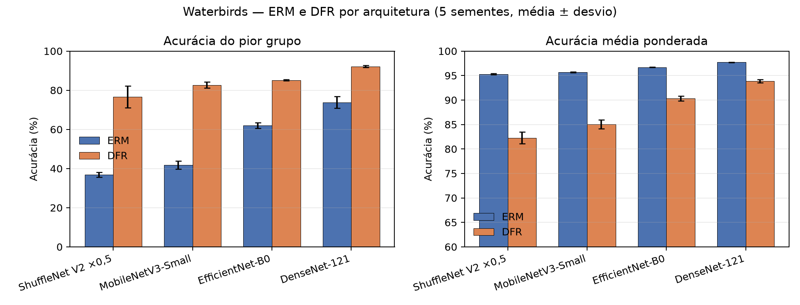

# Pessoa 2 — comparação das arquiteturas no Waterbirds

**Estado:** concluído em 17/11/2026. Quatro arquiteturas (ShuffleNet V2 ×0,5,
MobileNetV3-Small, EfficientNet-B0 e DenseNet-121) × cinco sementes × ERM e DFR,
com as divisões oficiais do Waterbirds v1.0.

**Pergunta:** com a mesma receita de ERM e o mesmo DFR, qual arquitetura tem a
maior acurácia no pior grupo, e em qual delas o DFR mais melhora essa métrica?

## Protocolo

- **Dados:** Waterbirds v1.0 oficial; 4.795 imagens de treino, 1.199 de validação
  e 5.794 de teste. Contagens dos grupos conferidas pelo `reproduction check`
  (SHA-256 do `metadata.csv`: `2f023b9d…6644362`).
- **Redes:** pesos ImageNet-1K V1 do torchvision para as quatro arquiteturas.
  A ResNet-50 é a quinta arquitetura, sob responsabilidade da Pessoa 1.
- **ERM:** rede inteira, 100 épocas, 224 × 224, lote 32, SGD com momento 0,9,
  `lr = 0,001` constante, `weight_decay = 0,001`, augmentação dos autores,
  checkpoint da última época.
- **DFR:** rede congelada, regressão logística L1 na última camada, `C` e pesos de
  classe escolhidos em metade da validação, validação balanceada (4 × 133 = 532
  exemplos) e média de 10 retreinos.
- **Sementes:** 1–5, fixadas antes da execução.
- **Ambiente:** RTX 5070 (Blackwell), `torch 2.11.0+cu128`,
  `torchvision 0.26.0`, Python 3.12.3. O PyTorch 2.5.1/cu124 fixado no
  protocolo não roda nessa GPU; a diferença está registrada nos manifestos.
- **EfficientNet-B0:** não havia execução anterior com este protocolo neste
  projeto nem no restante de `/Documents`; foi treinada do zero.
- **Confirmação inicial:** a primeira execução foi a ShuffleNet V2 ×0,5 com a
  semente 1, para verificar que o ERM e o DFR terminavam e produziam as métricas.
  Só depois as cinco sementes foram executadas nas quatro redes.

## Resultados

Média ± desvio amostral das cinco sementes. `pior` é a menor acurácia entre os
quatro grupos no teste; `ponderada` usa as frequências dos grupos no treino;
`micro` é a acurácia geral no teste; `gap` é máximo − mínimo entre grupos.

| Arquitetura | ERM pior | ERM ponderada | ERM micro | ERM gap | DFR pior | DFR ponderada | DFR micro | DFR gap |
| --- | ---: | ---: | ---: | ---: | ---: | ---: | ---: | ---: |
| ShuffleNet V2 ×0,5 | 36,9 ± 1,2 | 95,3 ± 0,1 | 80,7 ± 0,9 | 61,9 ± 1,1 | 76,7 ± 5,6 | 82,3 ± 1,2 | 81,0 ± 2,2 | 13,5 ± 8,7 |
| MobileNetV3-Small | 41,8 ± 2,1 | 95,7 ± 0,1 | 81,0 ± 0,9 | 57,2 ± 2,1 | 82,7 ± 1,5 | 85,0 ± 0,9 | 84,4 ± 0,5 | 5,7 ± 2,8 |
| EfficientNet-B0 | 62,0 ± 1,5 | 96,7 ± 0,1 | 85,4 ± 0,8 | 37,2 ± 1,4 | 85,2 ± 0,3 | 90,3 ± 0,5 | 88,3 ± 0,2 | 7,9 ± 0,9 |
| DenseNet-121 | 73,8 ± 2,9 | 97,7 ± 0,1 | 90,4 ± 0,6 | 25,6 ± 3,0 | 92,2 ± 0,5 | 93,8 ± 0,3 | 93,2 ± 0,3 | 2,1 ± 0,3 |

### Efeito do DFR por semente

`Δ pior` é `DFR − ERM` em pontos percentuais, calculado dentro de cada semente.
O intervalo é o de 95% para a média com t de Student (4 graus de liberdade).

| Arquitetura | Δ pior (média ± desvio) | IC95 | faixa | Δ ponderada | Δ micro |
| --- | ---: | ---: | ---: | ---: | ---: |
| ShuffleNet V2 ×0,5 | +39,8 ± 4,5 | ±5,6 | +32,3 a +43,6 | −13,0 | +0,3 |
| MobileNetV3-Small | +40,9 ± 1,6 | ±2,0 | +38,9 a +43,3 | −10,7 | +3,4 |
| EfficientNet-B0 | +23,1 ± 1,3 | ±1,6 | +21,7 a +25,1 | −6,4 | +2,9 |
| DenseNet-121 | +18,4 ± 3,0 | ±3,7 | +13,8 a +22,0 | −3,9 | +2,7 |

### Acurácia por grupo

Grupos: 0_0 = ave terrestre em terra; 0_1 = ave terrestre na água;
1_0 = ave aquática em terra; 1_1 = ave aquática na água.

| Arquitetura | ERM 0_0 | ERM 0_1 | ERM 1_0 | ERM 1_1 | DFR 0_0 | DFR 0_1 | DFR 1_0 | DFR 1_1 |
| --- | ---: | ---: | ---: | ---: | ---: | ---: | ---: | ---: |
| ShuffleNet V2 ×0,5 | 98,8 | 72,3 | 36,9 | 90,8 | 80,1 | 77,9 | 86,2 | 90,1 |
| MobileNetV3-Small | 99,0 | 71,1 | 41,8 | 91,8 | 84,1 | 83,1 | 85,8 | 88,4 |
| EfficientNet-B0 | 99,2 | 75,8 | 62,0 | 93,8 | 89,8 | 85,2 | 89,3 | 93,1 |
| DenseNet-121 | 99,4 | 84,7 | 73,8 | 95,6 | 93,8 | 92,3 | 93,0 | 94,2 |



## Leitura dos resultados

### 1. O ERM depende da capacidade e aprende o atalho, não o conceito

A ordem no ERM é monotônica na capacidade: ShuffleNet 36,9% < MobileNet 41,8% <
EfficientNet 62,0% < DenseNet 73,8%. A distância entre a menor e a maior é 36,9
pontos percentuais, com a mesma receita e os mesmos dados. A receita de 100
épocas foi desenhada para a ResNet-50; nas redes pequenas ela não extrai as
características centrais da ave.

O diagnóstico não é underfitting no treino. O pior grupo no **treino** chega a
89,3–94,6% na ShuffleNet e a ~100% nas outras três; no **teste**, fica em
35–79%. Os modelos classificam quase perfeitamente as 56 imagens minoritárias do
treino e falham nas 642 do teste. O problema é a generalização do conceito, não
a otimização.

### 2. O DFR comprime a diferença entre arquiteturas

O ganho é inversamente proporcional à qualidade do ERM: +39,8 na ShuffleNet,
+40,9 na MobileNet, +23,1 na EfficientNet e +18,4 na DenseNet. O DFR leva todas
para uma faixa estreita, 76,7–92,2%, contra 36,9–73,8% do ERM: a amplitude cai
de 36,9 para 15,5 pontos percentuais.

Há um teto. Mesmo com a última camada ideal, a ShuffleNet fica em 76,7% e a
MobileNet em 82,7%, longe dos 92,2% da DenseNet. A representação congelada das
redes pequenas não contém as características centrais necessárias; o DFR não as
cria. A conclusão “retreinar a última camada basta” vale melhor para as redes
maiores.

### 3. O custo na média ponderada é real, mas o micro melhora

O DFR perde 13,0 pontos na média ponderada da ShuffleNet, 10,7 na MobileNet, 6,4
na EfficientNet e 3,9 na DenseNet. O custo acompanha a capacidade: quanto melhor
o ERM, menos a média cai.

A média ponderada usa as frequências do **treino**, onde o grupo 0_0 é 73% do
total. O DFR reduz 0_0 para elevar 1_0; a média ponderada enxerga quase só essa
perda. A acurácia **micro** usa a distribuição do teste e mostra o outro lado:
+0,3 ponto na ShuffleNet, +3,4 na MobileNet, +2,9 na EfficientNet e +2,7 na
DenseNet. Nas três maiores, o DFR melhora a acurácia geral do teste, apesar de
piorar a média ponderada. As duas métricas respondem perguntas diferentes e
precisam ser reportadas juntas.

Exemplo na DenseNet: 0_0 cai 5,6 pontos (×2.255 imagens), 0_1 sobe 7,6 (×2.255),
1_0 sobe 19,2 (×642) e 1_1 cai 1,4 (×642). O saldo é +2,7 pontos de micro. Com
os pesos do treino, a queda de 0_0 domina e a média ponderada cai 3,9.

### 4. O pior grupo muda de lugar

No ERM, o pior grupo é sempre 1_0 (ave aquática em terra), o grupo com apenas 56
exemplos de treino. Depois do DFR, o pior grupo passa a ser 0_1 ou 0_0 — grupos
majoritários — em 19 das 20 combinações. A única exceção é a seed 1 da DenseNet,
que continua em 1_0.

O DFR não elimina o problema: ele desloca o gargalo. A acurácia do pior grupo
depois do DFR não mede mais o grupo minoritário; mede o grupo majoritário que
ficou para trás. Isso é importante para a interpretação: um DFR com pior grupo
de 92% pode estar deixando 1_0 em 93% e 0_1 em 92%, ou seja, equalizando os
quatro grupos em vez de privilegiar o minoritário.

### 5. O DFR é mais instável nas redes pequenas

O desvio do pior grupo no DFR é 5,6 pontos na ShuffleNet, 1,5 na MobileNet, 0,3
na EfficientNet e 0,5 na DenseNet. O intervalo de 95% da ShuffleNet é ±7,0
pontos; o da MobileNet, ±1,8. As duas se sobrepõem, então a ordem ShuffleNet <
MobileNet no DFR não é conclusiva com cinco sementes. O `C` escolhido varia de
0,03 a 1,0 entre sementes e arquiteturas: com 532 exemplos e 1.024–1.280
características, a seleção é ruidosa.

### 6. A DenseNet reproduz de perto a referência publicada

| Método | ResNet-50 no artigo — pior | ResNet-50 no artigo — ponderada | DenseNet-121 medida — pior | DenseNet-121 medida — ponderada |
| --- | ---: | ---: | ---: | ---: |
| ERM | 74,9 ± 2,4 | 98,1 ± 0,1 | 73,8 ± 2,9 | 97,7 ± 0,1 |
| DFR | 92,9 ± 0,2 | 94,2 ± 0,4 | 92,2 ± 0,5 | 93,8 ± 0,3 |

A DenseNet chega a 1,1 ponto do ERM publicado no pior grupo, a 0,7 do DFR no
pior grupo e a 0,4 nas duas médias ponderadas. Isso é evidência de que o
protocolo implementado está correto. **Não** é uma replicação da ResNet-50: é
outra arquitetura. A comparação direta com a Tabela 2 depende da execução da
ResNet-50 pela Pessoa 1.

### 7. A quinta arquitetura ainda falta

Não existe `runs/resnet50/` neste clone. A comparação com cinco arquiteturas
fica completa quando a Pessoa 1 entregar `protocol.json`, `results.csv`,
`summary.csv` e `paper_comparison.csv` da ResNet-50. O `paper_comparison.csv`
deste projeto só é gerado para `resnet50`; para as outras quatro, a comparação
é interna.

Para incorporar a ResNet-50 quando ela chegar, copie `runs/resnet50/` para este
clone e rode novamente:

```sh
python scripts/aggregate_results.py --output entrega_pessoa_2/resultados
python scripts/plot_person2_results.py \
  --summary entrega_pessoa_2/resultados/summary_all.csv \
  --output entrega_pessoa_2/resultados/comparacao.png
```

O agregador e a figura incluem automaticamente qualquer arquitetura que tenha
ERM e DFR nas cinco sementes; nenhuma mudança de código é necessária.

## Limitações

O detalhamento está em
[Limitações das abordagens implementadas](../docs/LIMITACOES_ABORDAGENS.md).
As que mais afetam esta comparação:

- A receita única foi desenhada para a ResNet-50 e não é neutra em relação à
  capacidade; ela mede “mesma receita”, não o melhor de cada arquitetura.
- O DFR usa rótulos de grupo e apenas 532 exemplos balanceados da validação,
  com seleção de `C` em uma única divisão. Isso explica parte da variância.
- O pior grupo é um mínimo de quatro estimativas; os grupos minoritários do
  teste têm 642 exemplos (erro-padrão binomial de ~2 pontos percentuais).
- Cinco sementes não estimam a incerteza do conjunto de teste nem cobrem a
  variação entre divisões. Não há teste estatístico pareado entre arquiteturas.
- A média ponderada é dominada pelo grupo 0_0 (73% do treino); a micro usa a
  distribuição do teste. As duas devem ser lidas juntas.
- A comparação entre arquiteturas confunde capacidade com qualidade e viés do
  pré-treino ImageNet; os pesos V1 não foram treinados com a mesma receita.
- A réplica é parcial: o artigo tem outras linhas e outras bases; aqui só as
  linhas Base (ERM) e DFR com validação balanceada no Waterbirds.
- O piloto em `results/` é um probe linear em características congeladas e não
  deve ser somado a estes números.

## Reprodutibilidade

```sh
python -m reproduction check
python -m reproduction run --architecture shufflenet_v2_x0_5
python -m reproduction run --architecture mobilenet_v3_small
python -m reproduction run --architecture efficientnet_b0
python -m reproduction run --architecture densenet121
python scripts/aggregate_results.py --output entrega_pessoa_2/resultados
python scripts/plot_person2_results.py \
  --summary entrega_pessoa_2/resultados/summary_all.csv \
  --output entrega_pessoa_2/resultados/comparacao.png
```

Arquivos desta entrega:

- `resultados/results_all.csv`: 40 linhas (4 arquiteturas × 2 métodos × 5 sementes).
- `resultados/summary_all.csv`: média, desvio e IC95 por arquitetura e método.
- `resultados/deltas.csv`: efeito do DFR em cada semente.
- `resultados/deltas_summary.csv`: resumo do efeito do DFR.
- `resultados/protocol_*.json`: manifesto de cada arquitetura.
- `resultados/comparacao.png`: figura com pior grupo e média ponderada.
- `runs/` (local, fora do Git): logs, checkpoints e JSONs brutos.
